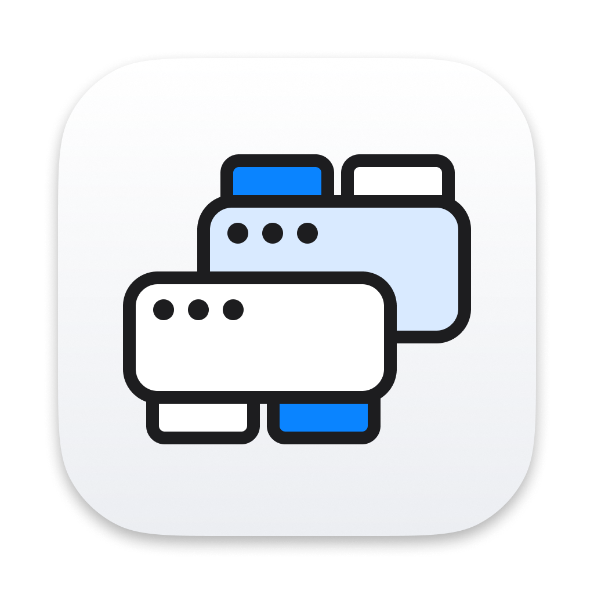
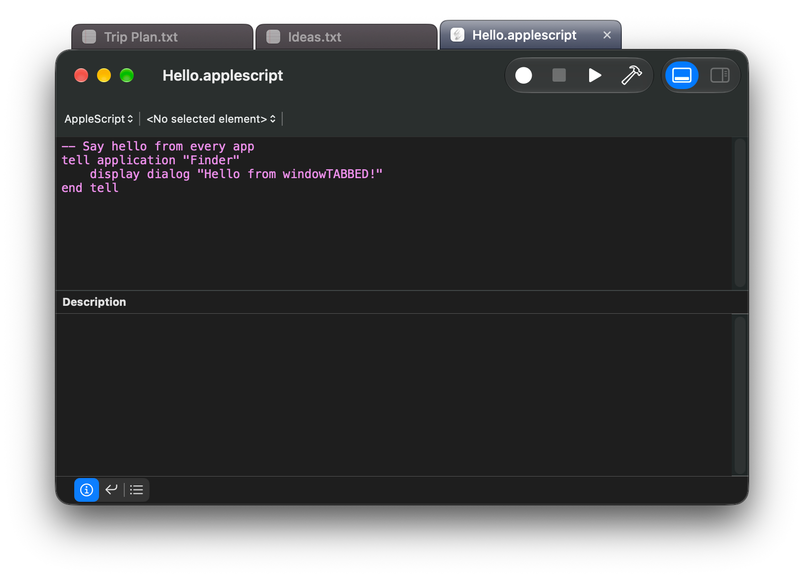

<p align="center">
  
</p>

<h1 align="center">windowTABBED</h1>

<p align="center">Browser-style tabs for any window on your Mac.</p>

windowTABBED is a small menu bar app that groups windows into tabs, even windows from different
apps. Hold a key, drag one window onto another, and they share a tab bar. Click a tab to switch.

<p align="center">
  
</p>

## Features

- **Group any windows.** Terminal next to Safari next to Notes, all in one stack.
- **Your choice of grouping key.** ⇧, ⌃, ⌥, ⌘ or fn, or record your own combination.
- **Tabs that stay in sync.** Moving or resizing the active window moves the whole group.
  Minimize one and the group minimizes, go full screen and the bar steps aside.
- **Drag tabs** to reorder them, or pull one out of the bar to take it out of the group. Choose what
  follows your pointer: the window itself, an outline of where it will land, or just the tab.
- **Smart placement.** The bar sits above the window, or flips below it when there's no room.
- **Themes**: Aqua, Liquid Glass and Retro 98, plus experimental Flat, Pill and Metallic.
- **Four sizes**, from Small to Extra Large, and **icon-only tabs** if you prefer a compact bar.
- **Keyboard shortcuts** (⌃⌥← / ⌃⌥→) to switch tabs, off by default.
- **Opens at login** if you like (Settings › General).
- **Private.** No network access, no analytics, nothing leaves your Mac.

## Requirements

- macOS 14 Sonoma or later. On macOS 26 and later the Settings window uses Liquid Glass.
- The Accessibility permission, which windowTABBED needs to move and raise other apps' windows.

## Install

1. Download the latest `windowTABBED-x.y.z.zip` from
   [Releases](https://github.com/Larieght/windowTABBED/releases) and unzip it.
2. Move `windowTABBED.app` to your Applications folder and open it.
3. macOS will say it can't verify the app, because it isn't signed with an Apple Developer ID.
   Open **System Settings › Privacy & Security**, scroll down and click **Open Anyway**.
4. When asked, allow windowTABBED in **System Settings › Privacy & Security › Accessibility**.
   You can also do this later from the menu bar icon: **Allow Accessibility…**
5. Pick your grouping key. windowTABBED asks on first launch.

> After an update, macOS may treat the new copy as a different app. If grouping stops working,
> remove windowTABBED from the Accessibility list and allow it again.

## How to use

| To | Do this |
|---|---|
| Group two windows | Hold the grouping key and drag a window by its title bar onto another window. A blue outline shows where it will land. |
| Add to a group | Do the same onto any window that's already grouped. |
| Switch tabs | Click a tab, or focus the window any other way (⌘-Tab, Dock, Mission Control). |
| Reorder tabs | Drag a tab along the bar. |
| Take a window out | Click the tab's **×** (the window stays open), or drag the tab off the bar. |
| Move the group | Drag the active window's title bar. |
| Ungroup everything | Menu bar icon › **Ungroup All**. |

A group with only one window left dissolves on its own. Quitting windowTABBED puts every window
back where you can see it.

Groups aren't saved yet, so they don't come back after you quit windowTABBED or restart your Mac.

## Build from source

You need the Swift toolchain from Xcode or the Command Line Tools (`xcode-select --install`).

```bash
git clone https://github.com/Larieght/windowTABBED.git
cd windowTABBED
scripts/build.sh release --install
```

This builds `build/windowTABBED.app`, copies it to `/Applications` and launches it. Use
`debug` instead of `release` for a debug build with test hooks.

macOS remembers the Accessibility permission by the app's signature. By default the script signs
ad-hoc, which changes every build, so you'd re-allow the permission each time. To avoid that,
create a self-signed code signing certificate named `windowTABBED Dev` once (Keychain Access ›
Certificate Assistant › Create a Certificate…, type **Code Signing**) and the script uses it
automatically. Set `WT_SIGN_IDENTITY` to use a different certificate.

## How it works

windowTABBED uses the macOS Accessibility API to watch, move and raise other apps' windows, and
draws each tab bar as its own small window just above the group. Background tabs are parked off
the corner of the screen rather than stacked behind the active window, so they don't trail
behind when you drag the group. [SPEC.md](SPEC.md) describes every rule in detail.

## Contributing

Bug reports and pull requests are welcome. When reporting a bug, include the version line from
the top of the menu bar menu (for example `windowTABBED 1.1.0 (ea3a993)`), your macOS version,
and your display setup.

## License

[MIT](LICENSE)
